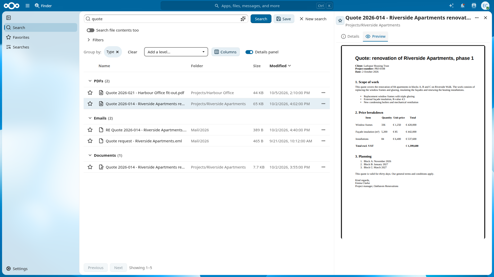

# DoCoNEXT Finder

A search app for your Nextcloud files, built for people who look things up all
day. Structured conditions, saved searches, configurable columns and grouping —
the things the Files app deliberately leaves out.

Finder works on a **plain Nextcloud**; nothing else needs to be installed.
Other DoCoNEXT apps add to it when they are there — see
[Better with other DoCoNEXT apps](#better-with-other-doconext-apps).



## Features

- **Structured search** — combine conditions on name, size, created and
  modified date, matching all of them or any of them. Date filters mean
  calendar periods, as the Files app does.
- **Search inside files** — on request, next to the name search that always
  runs, when the Full text search app is installed and indexing.
- **Saved searches** — name a search you run often and share it with people,
  groups or teams; recent searches are kept automatically.
- **Configurable columns** — choose which columns the result grid shows, in
  which order, and rename them to your own vocabulary.
- **Grouping** — by type, folder or date, stacked in several levels.
- **Favorites** — browse and toggle your favorite files from the same grid.
- **File commands** — open in Files or in the desktop app, go to the containing
  folder, preview, download, upload a new version or add files to a folder,
  straight from the result row.
- **Details panel** — resizable, with everything the server knows about the
  selected file, and a preview of it.
- Admin and personal settings, and a Dutch translation.

## Quick start

1. Open **Finder** from the top bar of your Nextcloud.
2. Type a term in the search bar and press Enter. It matches file and folder
   names; the same bar also offers your recent and saved searches.
3. To narrow it down, use **Add condition**: name, size, created or modified
   date. **Match:** decides whether a file must meet *all conditions* or
   *any condition*. The **Type** filter limits the results to documents,
   images, email and so on, and the folder scope searches inside one folder
   instead of everywhere.
4. Tick **Search file contents too** to also find files that mention the term
   in their text. The option is there only when the server has a full-text
   index; see [Searching inside files](#searching-inside-files).
5. **Columns** chooses which columns the grid shows, in which order and under
   which name; **Group by:** groups the results by type, folder or date.
   Both are remembered for you.
6. **Save** keeps the search under a name, and can share it in the same step.
   Your saved searches, the ones shared with you and the ones you ran recently
   are under **Searches** in the left navigation.

Each result row has a menu with the file commands — open, go to the folder,
preview, download and so on. Click a row to see its details in the panel on
the right. **Settings**, at the bottom of the navigation, holds your own
preferences: results per page, the sort order of new searches and what
double-clicking a result does.

## Requirements

- Nextcloud 33, 34 or 35
- PHP 8.2 or newer

## Installation

Install **DoCoNEXT - Finder** from the Apps page of your Nextcloud
(category *Files*), or from [apps.nextcloud.com](https://apps.nextcloud.com).

Finder works as soon as it is enabled. Everything under
[Configuration](#configuration) is optional, except for one setting: read
[Opening files on the desktop](#opening-files-on-the-desktop) if your users do
not have DoCoNEXT Bridge.

## Configuration

Administrators find Finder's settings under *Administration settings →
DoCoNEXT Finder*. Every setting can also be set with `occ`, which helps when
you set up several servers the same way.

### Opening files on the desktop

**Open in local app** hands a file to the Nextcloud desktop client, as the
Files app does: it opens the synced copy, so edits sync back. A few formats go
to **DoCoNEXT Bridge** instead, a separate helper on the user's computer. It
exists for formats no local application can open as they are: an Outlook
`.msg` opens in no mail client outside Windows until it is converted.

Which formats those are is the list in the settings page's first field. Until
an administrator saves one, it is `eml, msg`: Finder stores nothing on
installation, and that is the value it falls back to. **If your users do not
have the Bridge, empty the field and save**, and every file goes to the desktop
client. Add other formats to it, comma-separated, as they turn up.

With `occ`, the same two changes are:

```bash
occ config:app:set doconext_bridge extensions --value=''
occ config:app:set doconext_bridge extensions --value='eml,msg,oft'
```

The setting is filed under `doconext_bridge`, not `doconext_finder`, because it
describes the Bridge's routing, and other DoCoNEXT apps read the same value.

### File type filters

Which categories the search page's **Type** filter offers, and in what order.
The built-in categories — documents, spreadsheets, PDF, images, email and the
rest — can be hidden and reordered. You can also add your own: a label plus a
list of mimetypes, either exact (`application/acad`) or ending in a single
wildcard (`image/%`). A custom label is shown exactly as typed in every
language; the built-in ones are translated.

Set these on the settings page, which checks what you enter. To copy them to
another server, read the stored value on one and set it on the other:

```bash
occ config:app:get doconext_finder file_type_filters
occ config:app:set doconext_finder file_type_filters --value='<the JSON from above>'
```

`occ` stores the value without checking it, so copy only what the settings page
saved.

### Display name

Finder appears as **Finder** in the top bar and as **DoCoNEXT Finder** in the
settings. To give it a name your users already know, set:

```bash
occ config:app:set doconext_finder display_name --value='Document search'
```

This is set with `occ` only; there is no field for it on the settings page.
Remove the value to go back to the default:

```bash
occ config:app:delete doconext_finder display_name
```

### Searching inside files

Finder always searches names. It searches file contents as well when Nextcloud
has a full-text index, and it finds the index by itself. Setting one up takes
three apps and a search server:

1. Install **Full text search**, **Full text search - Files** and
   **Full text search - Elasticsearch** from the Apps page, and run an
   Elasticsearch server they can reach.
2. Configure the platform and the Files provider under *Administration
   settings → Full text search*.
3. Build the index:
   ```bash
   occ fulltextsearch:index
   ```
   Then keep it current; the
   [Full text search documentation](https://github.com/nextcloud/fulltextsearch/wiki)
   describes the options.

When the index is available, **Search file contents too** appears in the search
bar. A content search is ranked: Finder shows the best matches the index
returns, together with every name match, and says so above the results.

## Better with other DoCoNEXT apps

Finder is complete on its own. Two other DoCoNEXT apps add to it when they are
installed on the same server; Finder notices them by itself, with nothing to
configure. A third, DoCoNEXT Bridge, runs on the user's own computer instead.

### DoCoNEXT Files Preview

Shows the file itself in Finder's details panel and full-screen preview, where
Nextcloud on its own offers a thumbnail at best:

- emails (`.eml`) with their headers, body and attachment list, Markdown
  rendered, Word documents read in the browser, and PDF, images, video, audio
  and text inline;
- Excel and PowerPoint as well, when the server can convert them to PDF
  (Nextcloud Office / Collabora);
- **the words you searched for are marked in the preview**, so a match inside
  a file's contents is visible at once — in a colour you pick in your personal
  settings.

### DoCoNEXT Core

Core brings structured case and project management to Nextcloud: you define
the things your organisation works on — clients, matters, projects, cases —
each with its own folder structure, metadata fields, statuses and access
rules, organised in workspaces. With Core installed, Finder additionally:

- filters, groups and shows columns on Core's metadata fields, under the
  names each workspace gives them;
- narrows a search to a workspace, an entity type or a single entity;
- turns a question in plain language into filters;
- opens a result's entity in Core.

Core is available from DoCoNEXT, not from the App Store.

### DoCoNEXT Bridge

A helper on the user's computer that opens the files the Nextcloud desktop
client cannot. An Outlook `.msg` opens in no mail client outside Windows until
it is converted; the Bridge fetches the file, converts it where needed and
opens it on the computer. Finder sends a file there from
**Open in local app**, for the extensions an administrator lists — see
[Opening files on the desktop](#opening-files-on-the-desktop).

Unlike the two server apps, the Bridge cannot be detected from the server: a
browser cannot tell whether a computer handles a link. Which files go to it is
therefore a setting, not something Finder works out.

The Bridge is a desktop application, so it is not in the App Store; it is
available from DoCoNEXT.

None of the three is a dependency: Finder has no `<dependencies>` entry for
them, no compile-time coupling and no shared tables. It resolves Core's public
services by name on the server and the Preview app's renderer as a custom
element in the page; when either is not there, Finder answers as if it never
existed. The Bridge it reaches only through a `doconext://` link.

## Development

The Node version is pinned in `.nvmrc`; `npm install` refuses an older one.

```bash
nvm use
composer install                     # autoloader + dev tools (psalm, phpunit, …)
npm ci && npm run build              # or: npm run watch
php occ app:enable doconext_finder
```

Quality gates, all of which run in CI (`.github/workflows/ci.yml`):

```bash
composer lint && composer cs:check && composer psalm && composer test:unit
composer test:platform               # core search classes against a server checkout
npm run lint && npm run stylelint && npm run typecheck && npm test
make appstore                        # the release tarball
```

### Search backend

Search goes through `\OCP\Files\Folder::search()` — the same engine the WebDAV
DASL backend drives, reached directly. That matters: DASL only exposes the
properties `FileSearchBackend` chooses to declare, whereas the operator tree
accepts every filecache column in `SearchBuilder::$fieldTypes` (`path`,
`favorite` and `tagname` among them) and arbitrary and/or/not nesting.

Two sharp edges are handled in `lib/Search/FileCondition.php`:

- **Not every operator works on every field.** `SearchBuilder::validateComparison()`
  has a per-field whitelist; the cross-product would otherwise produce 500s.
- **`favorite` is a presence flag, not a boolean.** The builder rewrites it to
  `tag.category = <favorite tag>` and *discards* the supplied value, so
  `favorite eq false` would silently return favorites. Negating it does not help
  either — tag fields are joined, so `NOT` compares a NULL column and matches
  nothing. "Not favorited" is therefore rejected rather than answered wrongly.

## Security

Please report vulnerabilities privately; see [SECURITY.md](SECURITY.md).

## Contributing

Bug reports and feature requests are welcome and are read; code contributions
are not accepted. [CONTRIBUTING.md](CONTRIBUTING.md) explains why.

## License

Copyright © 2026 DoCoNEXT.

AGPL-3.0-or-later; the full text is in [LICENSE](LICENSE). Licensing follows
the [REUSE](https://reuse.software) layout: the licence texts are in
`LICENSES/`, and `REUSE.toml` says which covers which files.
